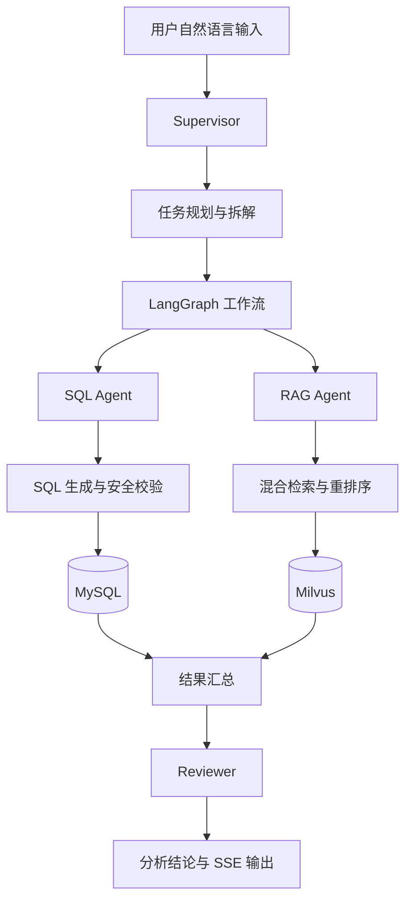

# Enterprise Agent｜企业智能数据分析与决策 Agent

基于大语言模型与 Agent 技术构建的企业智能数据分析系统，支持通过自然语言进行业务数据查询、企业知识检索与智能分析，帮助用户快速获取有依据、可追溯的业务决策结论。

## 项目简介

项目采用多 Agent 协作架构，将企业结构化数据与非结构化知识相结合，通过任务规划、工具调用、数据查询、知识检索和结果验证，构建完整的智能分析工作流。

## 核心功能

- **多 Agent 协作**：基于 LangGraph 构建 Supervisor + State 架构，实现任务识别、拆解、调度与执行。
- **智能数据分析**：基于 Text-to-SQL 将自然语言转换为 SQL，支持数据库 Schema 注入、SQL 安全校验及错误自修复。
- **企业知识检索**：基于 RAG 构建知识库，结合向量检索、BM25、RRF 融合及 Reranker 提升检索质量。
- **结果验证**：结合结构化数据与知识证据，通过 Reviewer 机制进行结果审核与冲突检测。
- **实时交互**：基于 SSE 实现 Agent 执行过程的实时反馈。

## 技术栈

| 分类 | 技术 |
|---|---|
| 开发语言 | Python 3.12 |
| Web 框架 | FastAPI |
| Agent 编排 | LangGraph、LangChain |
| 大语言模型 | DeepSeek |
| 关系型数据库 | MySQL 8 |
| 缓存 | Redis |
| 向量数据库 | Milvus |
| Embedding | BGE-M3 |
| Reranker | BGE-Reranker-v2-M3 |
| 检索技术 | Hybrid Search、BM25、RRF |
| 异步任务 | arq |
| 可观测性 | OpenTelemetry |

## 系统架构

## 核心技术亮点

1. **Agent 工作流编排**：通过 Supervisor 统一调度任务，利用 LangGraph 管理节点状态、条件路由及多步骤执行。
2. **SQL 安全控制**：通过 SQL AST 解析、白名单约束、只读数据库权限等多层机制，降低大模型生成 SQL 的安全风险。
3. **混合检索优化**：融合向量检索与 BM25 关键词检索，通过 RRF 和 Reranker 提升知识召回与排序质量。
4. **结果可信度控制**：利用 Evidence 与 Reviewer 机制，对数据结果和知识依据进行验证，减少错误结论与模型幻觉。

## 项目目标

构建一个具备自主任务规划、工具调用、知识检索、数据分析及结果验证能力的企业级智能 Agent，让自然语言成为连接企业数据与业务决策的入口。
